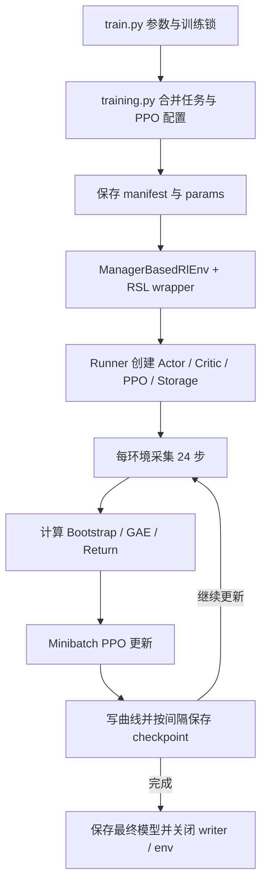

# G1 从训练到仿真部署：代码位置与完整操作过程

本文对应当前工作空间、mjlab **1.6.0**、RSL-RL **5.4.2**、G1 **29 自由度**。按本次确定的范围，流程到导出策略的仿真部署为止。每一步有单独 Python 程序，实际实现分文件并附中文注释。

本教程保留旧基线流程。新增 `velocity_robust`、`tracking_robust` 和无状态估计候选的来源、中文参数解释、训练入口及对照评估见 [训练配置优化依据与对照实验](训练配置优化依据与对照实验.md)。

## 1. 完整代码在哪里

训练链路由本空间的流程代码、mjlab 的任务/动力学代码、RSL-RL 的算法代码共同组成。`workspace/cli.py` 负责解析参数和分发命令；PPO 更新循环不在这个文件里。

| 要查看的内容 | 本空间代码 | 作用 |
| --- | --- | --- |
| 从零训练、续训 | [training.py](../workspace/common/training.py) | 配置、运行目录、checkpoint 恢复、启动 PPO、保存资源记录 |
| 回放、评估 | [inference.py](../workspace/common/inference.py) | 加载 actor、推理、终止统计、RMSE、可视化 |
| 评估协议 | [evaluation.py](../workspace/common/evaluation.py) | 固定机体系速度、存活比例、失败事件口径 |
| 导出 | [exporting.py](../workspace/common/exporting.py) | JIT/ONNX、数值对比、观测/动作清单、文件哈希 |
| 仿真部署 | [deployment.py](../workspace/common/deployment.py) | 仅加载 JIT，通过环境执行闭环控制 |
| 公共初始化与配置 | [runtime.py](../workspace/common/runtime.py) | 固定版本、任务注册、环境和 runner 构造 |
| 动作数据准备 | [motion.py](../workspace/common/motion.py) | CSV 重采样、四元数转换、正运动学、NPZ 检查 |
| 模型选择、关节映射、契约 | [contract.py](../workspace/common/contract.py) | 数字模型编号、29 关节映射、续训一致性 |
| 曲线与资源采样 | [telemetry.py](../workspace/common/telemetry.py) | TensorBoard 数据、吞吐、剩余内存/显存 |
| 耗时兼容 | [timing.py](../workspace/common/timing.py) | runner 使用单调时钟，避免时间回拨导致负耗时 |

上述依赖的源码副本也已加入当前仓库：[mjlab 1.6.0](../third_party/mjlab-v1.6.0/src/mjlab/)、[RSL-RL 5.4.2](../third_party/rsl_rl-v5.4.2/rsl_rl/)。可直接在 IDE 中搜索和阅读，入口及版本校验说明见 [third_party/README.md](../third_party/README.md)。副本包含全部 222 个 Python 文件，按源码仓库约定排除了网格和运行产物；修改副本不会自动影响训练。

实际使用的环境、奖励、网络和 PPO 源码位于 `.runtime-path` 指向的环境中。当前是：

```text
/home/godot/mjlab-isolated-v160/.venv/lib/python3.12/site-packages/
├── mjlab/
│   ├── asset_zoo/robots/unitree_g1/g1_constants.py  # 机器人、驱动、动作尺度
│   ├── envs/manager_based_rl_env.py                # step/reset 及物理推进
│   ├── envs/mdp/actions/actions.py                # 动作处理、位置目标
│   ├── envs/mdp/observations.py                   # 通用观测
│   ├── envs/mdp/rewards.py                        # 通用奖励
│   ├── tasks/velocity/
│   │   ├── velocity_env_cfg.py                    # 基础观测、奖励权重、随机化
│   │   ├── config/g1/env_cfgs.py                  # G1 平地/地形配置
│   │   ├── config/g1/rl_cfg.py                    # G1 网络和 PPO 超参数
│   │   └── mdp/                                  # 奖励、观测、速度命令、终止
│   ├── tasks/tracking/
│   │   ├── tracking_env_cfg.py                    # 模仿任务基础配置
│   │   ├── config/g1/env_cfgs.py                  # anchor、跟踪刚体、play 配置
│   │   ├── config/g1/rl_cfg.py                    # 模仿任务 PPO 配置
│   │   └── mdp/                                  # 参考动作、奖励、观测、终止
│   └── rl/                                       # runner、wrapper、导出支持
└── rsl_rl/
    ├── runners/on_policy_runner.py               # learn：采样 → GAE → 更新 → 保存
    ├── algorithms/ppo.py                         # PPO 损失、反向传播、优化器
    ├── models/mlp_model.py                       # Actor/Critic 网络
    ├── modules/normalization.py                  # 观测归一化
    └── storage/rollout_storage.py                # 轨迹缓存、回报、minibatch
```

不用手猜安装位置，可以直接输出当前解释器对应的绝对路径和关键函数行号：

```bash
cd /home/godot/g1-mjlab-workspace
bash g1.sh show-sources --kind velocity
bash g1.sh show-sources --kind tracking
# 独立程序，输出相同内容
bash g1.sh --python scripts/tools/show_sources.py --kind all
```

该工具只读包元数据和源码，不启动 GPU。`gym_rl/rsl_rl-main` 是参考资料，版本可能不同；训练实际调用上述已安装的 5.4.2。

## 2. 参考 gym_rl 的目录布局

采用参考项目的“独立 scripts + 源码包 + 配置 + 数据 + 产物”分工。现有 `workspace/` 就是本项目源码包，继续保留名称，现有模型清单和命令可继续使用。

```text
g1-mjlab-workspace/
├── g1.sh                                      # 固定解释器/缓存/线程启动器
├── scripts/
│   ├── reinforcement_learning/rsl_rl/
│   │   ├── train.py                           # 1. 从零训练
│   │   ├── resume.py                          # 2. 续训
│   │   ├── play.py                            # 3. checkpoint 交互回放
│   │   ├── evaluate.py                        # 4. 无窗口评估
│   │   └── export.py                          # 5. 导出策略
│   ├── deploy/deploy_sim.py                   # 6. 使用 JIT 仿真部署
│   ├── tools/
│   │   ├── import_motions.py                  # 复制两份参考 CSV
│   │   ├── prepare_motion.py                  # CSV → 当前模型 NPZ
│   │   └── show_sources.py                    # 查真实算法/任务源码
│   └── 00_check.sh … 14_show_config.sh         # 原有便捷启动脚本
├── workspace/                                # 实际实现，见上一节
├── profiles/                                 # 任务、并行数、更新数、PPO 覆盖
├── motions/{raw,processed}/                   # 原始 CSV 与转换 NPZ
├── outputs/
│   ├── runs/                                 # 正式训练模型、参数快照、曲线
│   ├── benchmarks/                           # 并行数短测，独立于正式 latest
│   ├── evaluations/                          # checkpoint 评估 JSON
│   └── deploy/                               # JIT/ONNX 部署包
├── docs/                                     # 本流程、接口、参考适配说明
├── tests/                                    # CPU 回归检查
├── third_party/                              # 固定版本依赖源码、许可证、校验清单
│   ├── mjlab-v1.6.0/src/mjlab/                # 环境、任务、奖励、机器人与 runner
│   └── rsl_rl-v5.4.2/rsl_rl/                  # PPO、网络、归一化与轨迹缓存
└── gym_rl/                                   # 用户提供的参考项目
```

对应关系：`gym_rl/.../scripts/.../train.py` 对应本空间同名训练入口；参考项目的 `source/.../tasks` 对应实际 mjlab 任务目录；参考 `rl_sar` 部署入口在本次范围内对应 `scripts/deploy/deploy_sim.py`。原参考项目使用 Isaac Lab/PhysX，这里继续使用当前 mjlab/MuJoCo/Warp。

## 3. 第一步：检查运行环境

以下所有命令在本空间根目录执行，无需激活虚拟环境：

```bash
cd /home/godot/g1-mjlab-workspace
cat .runtime-path
bash g1.sh doctor
bash g1.sh test
bash g1.sh self-check --profile velocity_flat_4096
```

`doctor` 报告版本与资源；`test` 执行 CPU 单元测试；`self-check` 创建 4 个环境执行 32 步零动作，不优化策略。零动作会转换成默认关节位置目标，不表示机器人必定站稳。

独立程序统一这样启动：

```bash
bash g1.sh --python scripts/reinforcement_learning/rsl_rl/train.py --help
```

`--python` 后面直接写程序路径和参数，不需要再加 `train` 子命令。它与原 `bash g1.sh train ...` 使用同一解释器、缓存和线程设置。也可在已正确配置的运行时直接 `python /绝对路径/程序.py ...`；推荐上述启动方式以保持环境一致。

## 4. 第二步：选择任务与并行环境数

| profile | 目标 | 动作文件 |
| --- | --- | --- |
| `velocity_flat_4096` | 官方平地速度跟踪基线 | 不需要 |
| `velocity_gym_ppo_4096` | 单独比较 entropy_coef=0.008，其余沿用 mjlab | 不需要 |
| `tracking_4096` | 带状态估计观测的动作模仿 | 需要转换后的 NPZ |
| `tracking_no_state_estimation_4096` | 删去指定状态估计观测的独立实验 | 需要 NPZ |

当前机器默认使用 4096 环境；新设备、新动作或显存被其他程序占用时，应重新做任务专用短测：

```bash
bash g1.sh benchmark --profile velocity_flat_4096 --envs 1024 2048 4096 --iterations 30
```

它会实际进行短训。环境数越大，每次 PPO 更新的采样批量越大；当前配置每环境 24 步，4096 环境每次更新得到 98304 条转移。改变环境数会改变优化行为，不只是改变运行速度。

## 5. 第三步：从零训练行走策略

```bash
bash g1.sh --python scripts/reinforcement_learning/rsl_rl/train.py \
  --profile velocity_flat_4096 \
  --envs 4096 \
  --iterations 3000 \
  --seed 42 \
  --name walk_4096
```

终端打印 `RUN_DIR=...`，记录这个目录。`--iterations 3000` 是 3000 次“采样 + PPO 更新”，不是 3000 个物理步，也不是稳定行走保证。

实际调用顺序：



单个控制步的过程如下：

1. 观测管理器读取状态和命令，按任务顺序计算观测、噪声及配置的前处理。
2. actor 根据观测分布采样 29 维动作。critic 用自己的观测估计价值；critic 可用额外状态，部署只需要 actor。
3. wrapper 处理动作裁剪；动作管理器计算关节位置目标：`q_target = action * scale + offset`，再执行配置的目标裁剪。scale 和 offset 以实际任务为准。
4. 物理引擎执行一个控制周期内的多个物理子步，驱动器根据目标推进机器人。
5. 环境计算奖励、失败终止和时间截断，对结束的环境自动复位，返回新观测。
6. PPO 保存观测、动作、对数概率、价值、奖励和终止信息；采满一轮后计算 GAE，再执行优化。

默认平地 actor 观测包括基座线速度、角速度、投影重力、相对关节位置、关节速度、上次动作和速度命令。确切顺序在安装版 `velocity_env_cfg.py`，部署时则读取导出清单的 `observation_terms`。不要使用参考资料中的旧维数替代当前接口。

当前官方平地网络：actor/critic 隐藏层均为 `(512, 256, 128)`，ELU，带观测归一化。默认 PPO 使用 `clip_param=0.2`、`gamma=0.99`、`lam=0.95`、5 个学习 epoch、4 个 minibatch、自适应学习率、`entropy_coef=0.01`；本空间将保存间隔设置为 100。完整生效值写入运行目录的 `params/agent.yaml`。

PPO 的主要量在固定版本 `ppo.py` 中可以逐项找到：

```text
ratio = exp(log_prob_new - log_prob_old)
policy_loss = -mean(min(ratio * advantage,
                        clip(ratio, 1-epsilon, 1+epsilon) * advantage))
loss = policy_loss + value_loss_coef * value_loss - entropy_coef * entropy
```

实际实现还包括价值裁剪、梯度裁剪和 KL 自适应调节。这里调用完整 RSL-RL 实现，详细源码通过 `show-sources` 定位。

产物布局：

```text
outputs/runs/<时间_profile_名字>/
├── run_manifest.json     # 任务/动作哈希、种子、版本、控制周期、来源模型
├── params/env.yaml       # 最终环境、机器人、观测、奖励、终止、随机化配置
├── params/agent.yaml     # 最终网络与 PPO 参数
├── events.out.tfevents.* # TensorBoard 曲线
├── model_0.pt …          # 定期保存，实际编号取决于训练进度
├── model_2999.pt         # 从 0 开始做 3000 次更新时的最终编号
└── resources.json       # 运行状态、剩余资源采样
```

## 6. 第四步：观察曲线并续训

另开终端查看曲线：

```bash
bash scripts/07_tensorboard.sh
# 浏览器：http://localhost:6006
```

读取日志及完整参数：

```bash
bash g1.sh summary --run latest
bash g1.sh show-config --checkpoint latest
```

续训推荐明确指定刚才记录的模型或运行目录：

```bash
MODEL="/home/godot/g1-mjlab-workspace/outputs/runs/替换成实际运行目录/model_2999.pt"
bash g1.sh --python scripts/reinforcement_learning/rsl_rl/resume.py \
  --checkpoint "$MODEL" --envs 256 --iterations 1000 --name walk_continue
```

续训会创建新目录，恢复模型和优化器等训练状态；原目录继续保留。这里新增 1000 次更新，正常编号接到 3999。`latest` 表示最新正式运行中数字最大的模型，不表示评估成绩最好，也不会选 benchmark 模型。

运行清单会检查 profile 文件哈希、任务、动作哈希、依赖版本和控制周期。修改 profile 后想比较新配置，应另起实验。只有没有清单的旧 `g1_continue` 才需要显式 `--legacy-velocity`，详见主 README。

## 7. 第五步：回放并定量评估

```bash
bash g1.sh --python scripts/reinforcement_learning/rsl_rl/play.py \
  --checkpoint "$MODEL" --viewer viser --port 8080
```

浏览器打开 `http://localhost:8080`，查看摔倒、滑脚、动作抖动、步态和命令响应。关闭回放后，再运行评估：

```bash
# 固定机体系前进速度 0.5 m/s，侧向 0，偏航角速度 0
bash g1.sh --python scripts/reinforcement_learning/rsl_rl/evaluate.py \
  --checkpoint "$MODEL" --envs 16 --seconds 60 --velocity-cmd 0.5 0 0

# 官方 play 命令采样协议，补充检查多个速度和转向命令
bash g1.sh --python scripts/reinforcement_learning/rsl_rl/evaluate.py \
  --checkpoint "$MODEL" --envs 16 --seconds 60
```

`seconds` 是每个环境的仿真秒数。指标和评估条件写到 `outputs/evaluations/<时间>.json`。

| 字段 | 含义 |
| --- | --- |
| `failure_terminations` | 总失败事件数，失败复位后再次失败会重复计数 |
| `environments_with_failures` | 至少失败过一次的环境数量 |
| `no_failure_fraction_over_horizon` | 此有限测试窗口内从未失败的环境比例 |
| `first_failure_time_seconds` | 各环境第一次失败时刻，未失败为 null |
| `termination_causes` | 各终止条件的触发数，条件可能同时触发 |
| `velocity_xy_rmse_m_per_s` | 平面速度误差向量的 RMSE，单位 m/s |
| `yaw_rate_rmse_rad_per_s` | 偏航角速度 RMSE，单位 rad/s |
| `evaluation_conditions` | 种子、命令、控制周期、噪声和推力条件 |

官方 play 关闭了部分训练扰动，因此应在相同评估条件下比较模型。评估期间失败后自动复位；画面持续有动作或命令正常退出，都不能替代失败统计。项目没有预设“达到某个 RMSE 就一定合格”的阈值。

## 8. 第六步：导出经过评估的模型

```bash
bash g1.sh --python scripts/reinforcement_learning/rsl_rl/export.py \
  --checkpoint "$MODEL"
```

程序打印 `DEPLOY_BUNDLE=/.../outputs/deploy/...`。导出按以下顺序执行：

1. 根据 checkpoint 恢复官方 play 环境，只加载 actor 推理状态。
2. 从真实仿真采集 32 组 actor 输入和原策略动作。
3. 导出包含观测归一化器的 `policy_jit.pt`，在 CPU 上推理并与原策略比较。容差为 `atol=1e-4, rtol=1e-4`，不通过则报错。
4. 导出 `policy.onnx` 并执行 ONNX 结构检查。tracking ONNX 还包含时间索引和参考轨迹输出，接口按清单读取。
5. 从实际环境记录观测组/项顺序、维数、动作关节、scale/offset、裁剪、PD 元数据、关节映射和控制周期。
6. tracking 复制 `motion.npz` 到包内；最后写文件哈希。

部署包：

```text
outputs/deploy/<模型标识>/
├── policy_jit.pt           # 本流程仿真部署实际加载的策略
├── policy.onnx             # 另一种导出格式，仅检查结构
├── manifest.json           # 真实观测/动作接口、版本、任务、数值误差
├── hashes.json             # 静态产物的 SHA-256
├── hardware_template.json  # 原有禁用模板，当前仿真流程不用
└── motion.npz              # 仅 tracking 任务存在
```

训练 checkpoint 包含恢复学习所需状态；JIT/ONNX 用于推理。不要把 `policy_jit.pt` 传给 resume。ONNX 结构检查不包含 ONNX Runtime 数值验证；本流程使用经过数值对比的 TorchScript。

## 9. 第七步：使用导出包进行仿真部署

把导出时打印的真实目录填入：

```bash
BUNDLE="/home/godot/g1-mjlab-workspace/outputs/deploy/替换为实际导出目录"

# 先做无窗口回归，默认 1 个环境，保存统计结果
bash g1.sh --python scripts/deploy/deploy_sim.py \
  --bundle "$BUNDLE" --headless --seconds 60

# 再打开网页查看导出策略闭环表现
bash g1.sh --python scripts/deploy/deploy_sim.py \
  --bundle "$BUNDLE" --viewer viser --port 8080
```

部署代码校验哈希和任务契约，只创建环境与 wrapper；**不创建 PPO runner，不加载训练 checkpoint**。环境按同一任务语义构造观测，JIT 得到动作，再由相同动作管理器和物理引擎推进。headless 结果写入包内 `simulation_result.json`。

本次完成的是同一 mjlab 后端的导出策略部署与回归。它仍需要当前固定依赖和匹配的 profile；部署包没有打包 Python 解释器、物理引擎或机器人资源。它也不是独立 MuJoCo 控制器的 sim2sim。观测、归一化、动作映射的详细约定见 [deployment_contract.md](deployment_contract.md)。

## 10. 动作模仿任务的完整分支

速度跟踪不需要参考动作。要训练 `dance_102`，在训练前执行：

```bash
# A. 默认优先搜索当前工作空间里的 gym_rl
bash g1.sh --python scripts/tools/import_motions.py

# B. 用当前 G1 模型在 CPU 做正运动学与重采样
bash g1.sh --python scripts/tools/prepare_motion.py dance_102

# C. 检查数据以及跟踪环境
MOTION="/home/godot/g1-mjlab-workspace/motions/processed/dance_102.npz"
bash g1.sh inspect-motion "$MOTION"
bash g1.sh self-check --profile tracking_4096 --motion "$MOTION"

# D. 从零训练另一个任务；当前机器默认使用已通过容量短测的 4096
bash g1.sh --python scripts/reinforcement_learning/rsl_rl/train.py \
  --profile tracking_4096 --motion "$MOTION" --envs 4096 --iterations 10000 --name dance_102
```

CSV 每帧 36 列：根 xyz、根 xyzw 四元数、29 个 SDK 顺序关节角。转换时执行：

1. 60 Hz 数据按实际时间重采样到控制频率；关节/位置线性插值，四元数最短弧 SLERP。
2. 四元数转换为 wxyz 并统一符号连续性。
3. 根据名字将 SDK 关节列重排到当前模型关节顺序。
4. 对每帧调用 MuJoCo 正运动学，获得当前模型所有刚体的世界位姿。
5. 计算关节速度、世界线速度和世界角速度，写出 NPZ 和转换说明。

NPZ 检查会核对字段、形状、有限值、关节/刚体名字顺序及采样频率。运动学有效不等于接触和动力学可行，仍需查看转换 JSON 的关节越限情况和训练后的跟踪误差。

训练完成记录该任务的实际 checkpoint：

```bash
TRACK_MODEL="/home/godot/g1-mjlab-workspace/outputs/runs/替换为跟踪运行目录/model_9999.pt"
bash g1.sh --python scripts/reinforcement_learning/rsl_rl/play.py --checkpoint "$TRACK_MODEL"
bash g1.sh --python scripts/reinforcement_learning/rsl_rl/evaluate.py \
  --checkpoint "$TRACK_MODEL" --envs 16 --seconds 60
bash g1.sh --python scripts/reinforcement_learning/rsl_rl/export.py --checkpoint "$TRACK_MODEL"
# 然后把该次 DEPLOY_BUNDLE 路径交给 deploy_sim.py，与速度任务相同。
```

动作路径和 profile 从运行清单恢复。跟踪评估不传 `--velocity-cmd`，主要看关节角 RMSE、身体位置误差和失败统计。两个 state-estimation profile 的 actor 观测不同，应分别训练。

## 11. 常见问题与本次验证范围

| 现象 | 检查位置或处理方式 |
| --- | --- |
| 找不到 mjlab 或版本不匹配 | `cat .runtime-path`、`bash g1.sh doctor`，确认使用固定运行时 |
| 想看奖励函数却只找到命令入口 | `show-sources --kind velocity`，先看基础环境的权重，再看 mdp/rewards.py |
| `Resume contract differs` | 对比清单/profile/动作/版本；新配置用新实验 |
| 误加载了另一个任务的 latest | 明确指定 `$MODEL` 或运行目录 |
| 跟踪数据顺序或频率不一致 | 用当前 prepare_motion.py 从 CSV 转换，不能直接混用 Isaac NPZ |
| 部署哈希不一致 | 使用完整、未修改的那次部署包；需要更换策略时重新导出 |
| Viser 端口占用 | 加 `--port 8081` |
| GPU 不可用 | doctor 中资源为空时检查实际运行环境，CPU 测试通过不表示 GPU 仿真通过 |

本次拆分通过 CPU 回归、独立入口帮助/参数检查、Bash/Python 语法检查与安装源码定位检查。当前执行环境未提供可用 CUDA 设备，未在此启动 GPU 训练、导出或仿真部署。实际模型的导出数值一致性与部署回归，需以上述程序成功运行后产生的结果为准。
